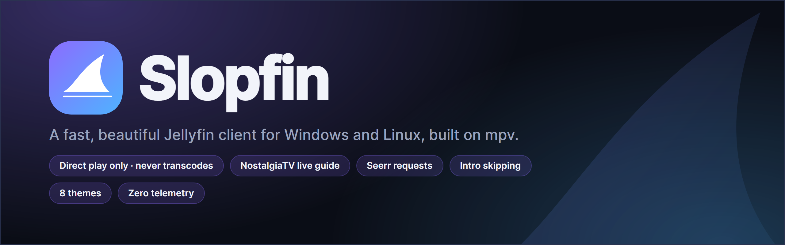
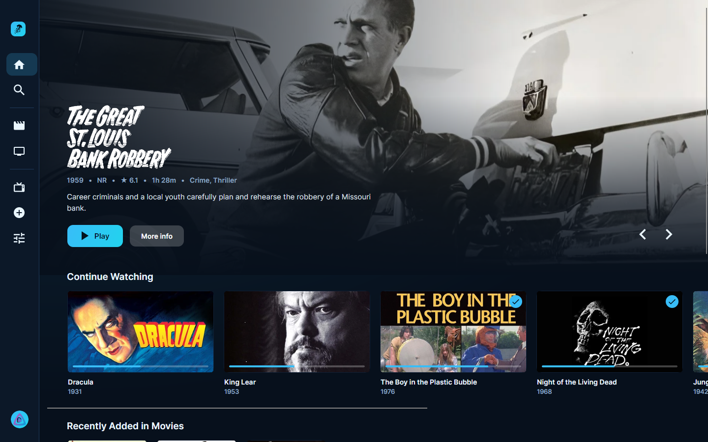
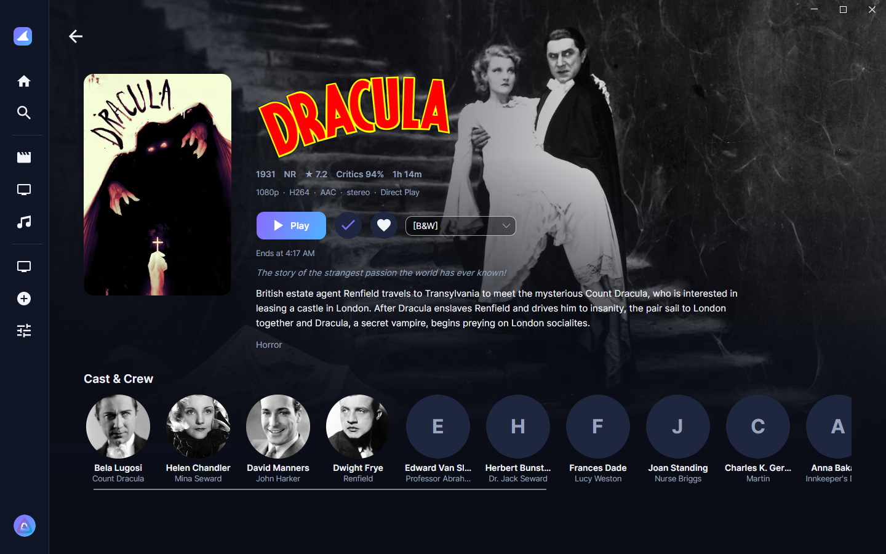
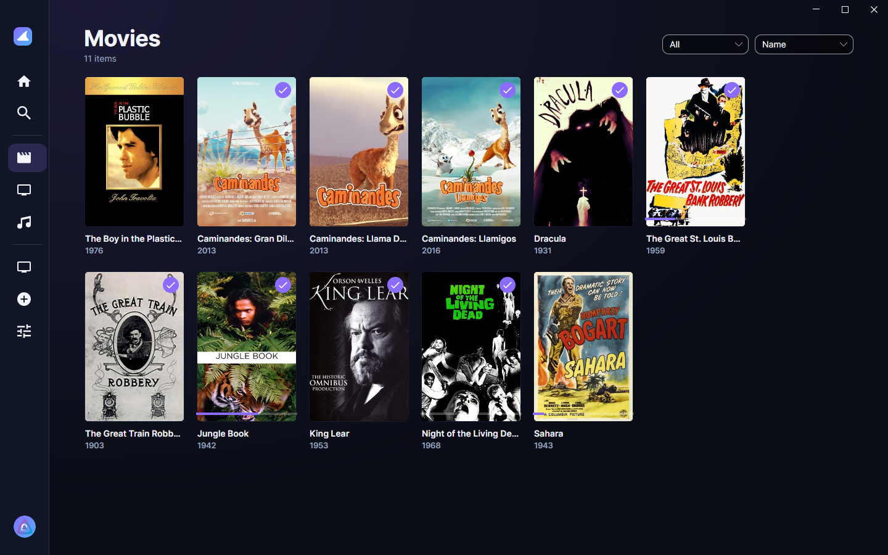
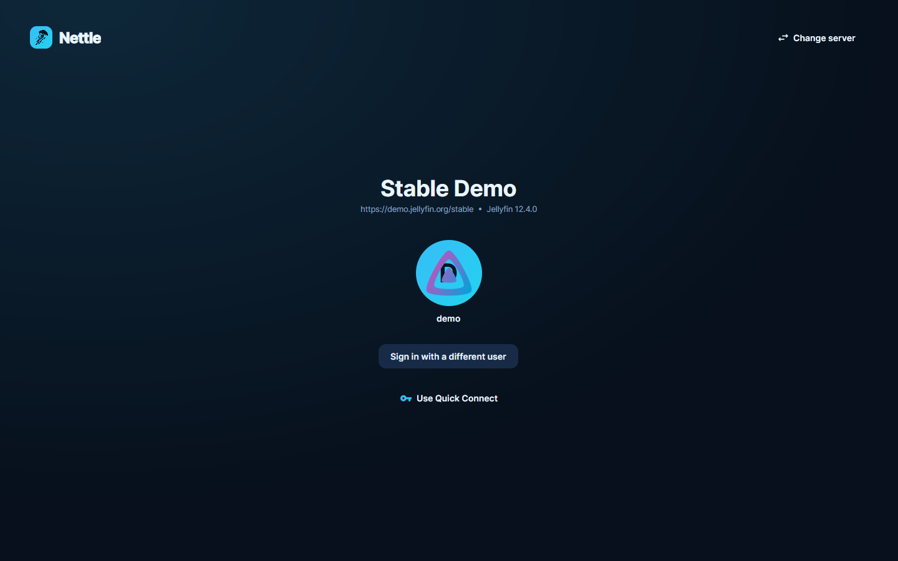
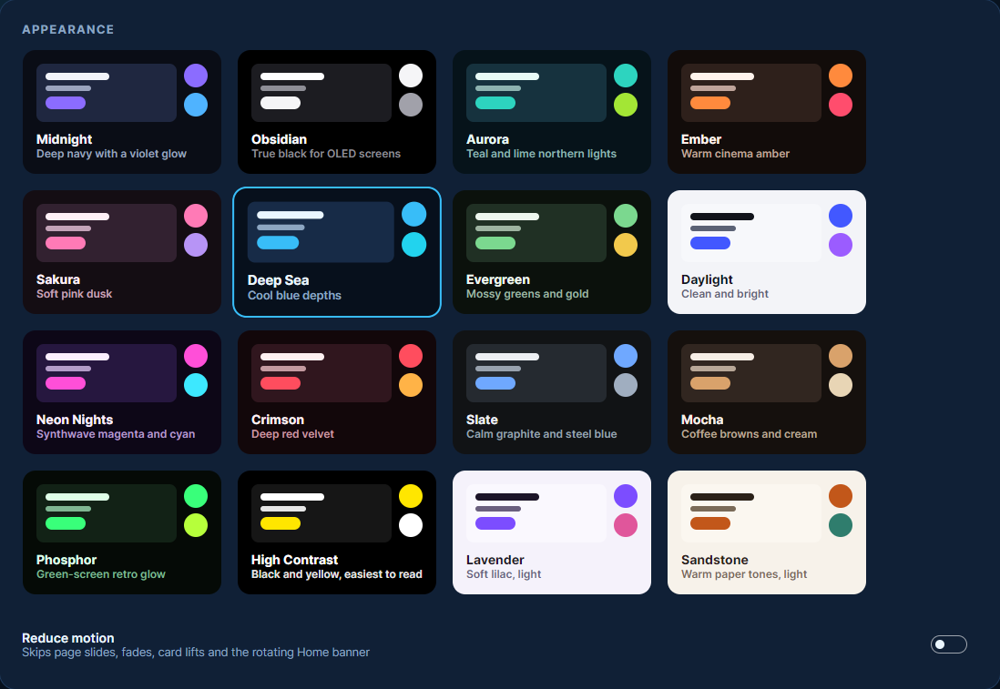

<p align="center">
  
</p>

<p align="center">
  <b><a href="https://devall96.github.io/Nettle/">⬇ Download Nettle for Windows, Linux or Android TV</a></b>
  &nbsp;·&nbsp; <a href="#-testers-wanted">Testers wanted</a>
  &nbsp;·&nbsp; <a href="#features">Features</a>
  &nbsp;·&nbsp; <a href="#install">Install</a>
  &nbsp;·&nbsp; <a href="#android-tv">Android TV</a>
  &nbsp;·&nbsp; <a href="#using-nettle">Using Nettle</a>
  &nbsp;·&nbsp; <a href="#privacy">Privacy</a>
  &nbsp;·&nbsp; <a href="#building-from-source">Build</a>
</p>

---

**Nettle** is a Jellyfin client for Windows, Linux and **Android TV** that plays everything in
**original quality**. Instead of asking your server to transcode, it plays the actual file: with the
**mpv** engine on PCs, and with **Media3** (the TV's own hardware decoders) on Android TV, for 4K,
HDR and Dolby Vision. Nettle never transcodes: it has no code path that asks the server to.

It also brings in a TV-style live guide for **NostalgiaTV**, **Seerr** requests, skippable intros
and credits, multiple profiles, and sixteen hand-made themes. It has **no telemetry of any kind**.

> [!IMPORTANT]
> ### 🆕 New in 0.6.0
> **Watch together** (Jellyfin SyncPlay) across Windows, Linux and Android TV, **HDR that turns on
> and off with the video** on Windows, a calmer player (the pointer and controls stay out of the
> way), per-profile Seerr sign-ins, and many fixes from a full review of all three apps.
> [What's in 0.6.0](https://github.com/devall96/Nettle/releases/tag/v0.6.0)

> [!IMPORTANT]
> ### 📺 Nettle for Android TV
> Since 0.4.2, Nettle runs natively on **Android TV and Google TV** boxes and televisions. It isn't
> a port of the desktop window: it was rebuilt in Kotlin and Jetpack Compose for the remote, with
> the same look, themes and features as the PC version.
> - **Original files only**, through Media3 and the TV's hardware decoders: HDR10, HLG, HDR10+ and
>   Dolby Vision go to your TV as they are, refresh rate follows the video, and audio passthrough
>   sends Dolby and DTS to your receiver.
> - **Live TV that feels like cable:** surf with Up / Down, type a channel number, jump back to the
>   last channel, and a tuning screen covers each switch.
> - **Fast on cheap boxes:** about 0.8 s from a cold start to your Home screen on a 2 GB onn 4K box.
> - Home, libraries, details, search, NostalgiaTV, Seerr, intro skipping, Quick Connect,
>   multiple profiles and **watch together**, all driven by the D-pad.
>
> - **Updates itself** from Settings → Updates, like the PC version.
>
> **Install:** in the **Downloader** app on your TV, enter the code **3148086**.
> [Full steps ↓](#android-tv)

> [!NOTE]
> **Nettle is in beta on Windows, Linux and Android TV.** It works well on the devices it has been
> tested on, but it hasn't been tried on much other hardware yet, so expect some rough edges.
>
> **Entirely AI-coded, single-user tested.** All of Nettle's code was written by an AI coding
> assistant (Anthropic's Claude), directed and reviewed by one person. So far it has been tested by
> that one person, on one Windows PC, one Ubuntu PC and one onn 4K Google TV box. That's why
> [testers are wanted](#-testers-wanted).

> [!TIP]
> **Nettle used to be called Slopfin.** If you installed Slopfin 0.1 or 0.2, **Settings → Updates**
> brings you to Nettle, and your settings and saved sign-ins come along.
> [More about the name change](#about-the-name).

## 🧪 Testers wanted

Nettle needs people to try it on hardware it hasn't seen yet: **NVIDIA and Intel graphics,
laptops, other Linux distros and desktops (KDE, XFCE…), multi-monitor and HDR setups, and Android TV
devices other than the onn 4K (NVIDIA Shield, Chromecast with Google TV, Google TV Streamer, TVs with
Google TV built in…).** If you have a Jellyfin server and a few minutes, you'd help a lot:

1. [Download](https://devall96.github.io/Nettle/) the Windows installer, the Linux AppImage or the Android TV app.
2. Sign in and play a few different things: 4K / HDR / Dolby Vision files, older SD shows, surround
   audio, subtitles, and Live TV if you use NostalgiaTV.
3. Tell us what broke, or that it worked, by
   [opening an issue](https://github.com/devall96/Nettle/issues/new?template=bug_report.md). Please include:
   - Windows, Linux or Android TV. On Linux, also the distro and desktop (e.g. *Fedora 41, KDE Plasma 6, Wayland*). On Android TV, the device (e.g. *NVIDIA Shield Pro 2019*) and your TV / receiver.
   - Your graphics card (e.g. *AMD RX 9070*, *NVIDIA RTX 3060*, *Intel Arc*), on a PC.
   - What you played: resolution, HDR type and audio format. Nettle's format badges (press **I** while playing) show all of this.
   - A screenshot, if it's visual.
   - The end of Nettle's log: `%LOCALAPPDATA%\Nettle\nettle.log` on Windows, or
     `~/.local/share/Nettle/nettle.log` on Linux. On Android TV, if you use adb:
     `adb logcat -d -s Nettle`. Server tokens in the log are already masked, but you may want to blank
     out your server's address.

"It worked fine on my setup" reports are just as useful, so they're welcome too.

## Screenshots

<p align="center"></p>

| | |
|---|---|
|  |  |
|  |  |

<sub>Screenshots show Jellyfin's public demo server.</sub>

## Features

### Playback
- **Direct play, always.** Nettle requests the original file and never asks the server for a transcode or remux. Your server's CPU stays idle and the picture is untouched.
- **mpv engine** (libmpv) with its modern renderer (`gpu-next` / libplacebo) and hardware decoding: D3D11VA on Windows, VA-API on Linux. It plays practically every container, codec and subtitle format.
- **HDR10, HDR10+, HLG and Dolby Vision,** including **Dolby Vision profile 5**, whose picture data is applied by the player. On Windows, HDR goes straight to your HDR display; on SDR screens it's tone-mapped carefully.
- **HDR follows the video on Windows** (Settings → Appearance → *Match HDR to the video*): like a TV, Windows' HDR turns on for HDR videos and off for SDR ones, then goes back to how it was when you leave the player.
- **Smooth motion.** Playback syncs to your display's refresh rate, so 24 fps films don't judder on 60 Hz screens.
- **TV-style format badges.** When playback starts, badges like **4K · DOLBY VISION · DOLBY ATMOS** pop up, the way a TV shows them. Each badge is *verified*:
  - Resolution comes from the frames actually being decoded.
  - HDR is only claimed if the player is really sending an HDR signal, and Windows confirms your monitor is in HDR mode.
  - Audio formats only appear once that audio is actually being decoded.
- **Skip intro, recap, credits, previews and ads,** using the [Intro Skipper](https://github.com/intro-skipper/intro-skipper) plugin or Jellyfin media segments. Each one can show a button, skip automatically, or do nothing.
- **Up Next** card with a countdown during the credits, then automatic next episode.
- **"Are you still watching?"** After a few episodes in a row with no input (3 by default), or 4 hours of Live TV, Nettle pauses and asks. You can change the count or turn it off in **Settings → Playback**.
- **Scrubbing with previews,** the way TV streaming apps do it. Press **←** / **→** (or Left / Right on a remote) and the video pauses while a thumbnail preview moves along the seek bar: a tap moves 10 seconds, holding glides smoothly and speeds up the longer you hold. **Enter** (OK) jumps there and carries on playing; **Esc** (Back) cancels and carries on from where you were. With a mouse, hover over or drag the seek bar. Thumbnails come from the trickplay images your Jellyfin server already generates.
- **Audio passthrough** (optional): Dolby Digital, Dolby Digital Plus / Atmos, TrueHD, DTS and DTS-HD / DTS:X go to your AV receiver untouched, so it decodes them, height channels included.
- Resume points, watched status and your audio / subtitle choices stay in sync with your server. Closing Nettle mid-episode still saves where you were.
- **Remembers your languages per series:** pick other audio or subtitles in one show, and its other episodes start that way.
- **Rides out network drops:** after a short Wi-Fi or server hiccup the video reconnects at the same spot by itself.
- **The mouse pointer and the controls stay out of the way** while a video plays, and come back when you move the mouse.
- Audio and subtitle track menu, including external subtitles. Adjustable network buffer for slow Wi-Fi, sized to each file's bitrate so even 4K remuxes really get that much read-ahead.
- **Fine-tuning while you watch:** playback speed, subtitle and audio timing, and subtitle size. Speed and subtitle size are remembered, and so is **audio timing, for your screen and separately for each refresh rate** (many TVs delay their picture in film mode only).
- **Lip sync check** (Settings → Playback): a small grey box blinks once a second with a beep, and you nudge the sound in 10 ms steps until they line up. It's saved for the refresh rate your screen is running at. ⚠ It blinks for as long as it's open: if you or anyone watching (pets included) has epilepsy or is sensitive to flashing or blinking light, don't run it.
- **Chapters:** marks on the seek bar, chapter names in the scrubbing preview, and Page Up / Page Down to jump between them.
- **Find subtitles online** from the player, through your server's subtitle plugins (such as Open Subtitles). Nettle itself only talks to your server.
- **Subtitles turn on the way you like:** default track, always, only forced (foreign dialogue), smart (when the audio is in another language), or off. By default this, and your audio and subtitle languages, follow each person's own Jellyfin profile.
- **Play all and Shuffle** for libraries and collections, and **Shuffle for a whole series** (every episode of every season, in random order).
- **Play on Nettle from other Jellyfin apps.** Nettle shows up as a "Play on" target: your phone can start, queue, pause, seek, skip and change the volume or tracks.
- **Watch together (SyncPlay).** Start or join a group from *Watch together* on the rail, then play anything: it plays for everyone in the group at the same moment, on Windows, Linux, Android TV and other Jellyfin apps that support SyncPlay. Pausing, seeking and skipping happen for everyone, and players that drift apart are brought back in step.

### On Android TV
Everything above and below works on the TV too, with these differences:
- **Media3 instead of mpv,** using the TV box's own hardware decoders. HDR10, HLG, HDR10+ and Dolby
  Vision frames go to the TV as they are (on TVs without Dolby Vision, profile 7 and 8 files play
  their HDR10 layer instead). The format badges say what your TV really received.
- **Refresh-rate matching** switches the TV to 23.976 / 24 / 25 / 50 / 59.94 Hz to match each video,
  and can match the resolution too (Settings → Playback).
- **Audio passthrough** sends Dolby Digital, Dolby Digital Plus / Atmos, TrueHD and DTS to your
  receiver when your box and receiver support it. With passthrough off, Dolby audio is decoded on
  the box.
- **Remote buttons:** Left / Right scrub (see above: OK jumps, Back cancels), Up / Down surf channels
  on Live TV when the controls are hidden, number keys type a channel number (or jump 10 % at a time
  in a video), and Channel up / down, Last channel, Guide, Audio track, Captions and Info buttons work
  on remotes that have them. In a video, Channel up / down jump between chapters, Fast-forward /
  Rewind jump three seek steps, and Next / Previous move through the queue. Press Back twice on the
  home screen to close Nettle.
- **Interface size** (Settings → Appearance): Small, Medium, Standard (the same proportions as the
  Windows app) or Large, to suit how far you sit from the TV.
- **No volume slider:** your remote sets the TV's (or receiver's) own volume, and Nettle always plays
  at full level.
- **Settings work with the remote:** every row, dropdowns and number settings included, takes focus
  as a whole; OK opens a list, Left / Right change a number.
- **Live TV tuning screen** with the channel's logo while a channel switches, so letterboxed films
  never flash stretched.
- The same 1440-wide layout as the PC version, scaled to your TV, so it looks the same.
- **Saved sign-ins are encrypted** with a key that never leaves the TV's secure hardware
  (Android Keystore), and the app never takes part in cloud backups.
- Not on the TV yet: music (music libraries are hidden), subtitle timing, and a software decoder
  for DTS / TrueHD when passthrough is off.

### Browsing
- **Home:** a spotlight carousel with logo art, plus Continue Watching, Next Up, and Recently Added for each library (except libraries you hid from it in Jellyfin). It appears instantly at startup, from your last visit, while fresh data loads.
- **Libraries:** a fast grid that only draws the posters on screen, with sort and filters (unwatched, in progress, favorites, genre, decade, 4K / HD / SD), and an A–Z strip to jump through long libraries.
- **Details:** backdrop, logo, ratings, file info, cast and crew, seasons and episodes, trailers and extras stored on your server, More Like This, and a version picker. Click anyone in the cast to see everything they're in.
- **Search** across your library, by kind (movies, shows, episodes…). With Seerr set up, titles you don't have yet appear below, ready to request.
- Stays current: watched status and new items from other devices show up without a refresh.

### Live TV: NostalgiaTV
- A full cable-style **program guide** covering everything NostalgiaTV has scheduled (usually several days), with a live "now" line. Scroll through it, or jump ahead 90 minutes at a time. It opens instantly on later visits, and stays fast however far ahead NostalgiaTV schedules.
- **Original-quality channels.** By default Nettle plays each scheduled program's real file from your Jellyfin server at the live position, instead of NostalgiaTV's re-encoded broadcast feed.
  - It joins mid-program and rolls into the next show automatically.
  - Channel up/down works with the keyboard or the on-screen buttons.
- Channels with nothing scheduled are hidden.
- Only live channels appear. **NostalgiaTV's On Demand section is deliberately not included.**

### Requests: Seerr
- Browse Trending, Popular and Coming Soon, search, and request movies with one click. For series, **pick the seasons** you want; seasons you already have or requested are shown as such.
- See your own requests and their status (only yours, even if your Seerr account is an admin).
- Sign in with an API key, or with your Jellyfin username and password. Only the resulting session is kept, encrypted, and **each profile has its own**, so nobody requests as someone else.

### Accounts and sign-in
- Finds Jellyfin servers on your network automatically. You can also pick http or https and type just the IP; the port is added for you.
- **Sets up Live TV and Requests by itself:** NostalgiaTV and Seerr running on the same machine as Jellyfin are found and connected after you sign in.
- Sign in with profile tiles, a password, or **Quick Connect**.
- **Multiple profiles** with a "Who's watching?" picker, quick switching, and optional automatic sign-in.
- **Passwords are never stored.** Only Jellyfin's session token is kept: on Windows it's encrypted with DPAPI for your Windows account, on Linux it goes into your desktop keyring (GNOME Keyring, KWallet, KeePassXC…), and on Android TV it's encrypted with a key kept in the TV's secure hardware (Android Keystore).

### Look and feel
- **Sixteen original themes** (Settings → Appearance → Change theme): Midnight, Obsidian (true black for OLED), Aurora, Ember, Sakura, Deep Sea, Evergreen, Neon Nights, Crimson, Slate, Mocha, Phosphor, High Contrast, and three light ones: Daylight, Lavender and Sandstone. Switching is instant.
- Smooth, lightweight animations, a navigation rail that expands over the page, and fade-in artwork. **Reduce motion** in Settings turns the animations off.
- **Ready for keyboard and TV remotes.** Arrow keys move focus the way a TV remote's d-pad does.
- **Display mode** (Settings → Appearance, Windows and Linux): *Windowed*, *Borderless* full screen (easy to Alt-Tab), or *Exclusive* full screen, where on Windows the monitor's refresh rate follows the video. **F11** switches between windowed and full screen.
- Remembers its window size and position, and only one copy runs at a time (opening it again brings the open window forward).

## Install

### Windows

1. Download **`Nettle-win-Setup.exe`** from the [latest release](https://github.com/devall96/Nettle/releases/latest).
2. Run it. It installs for your user account only, so no admin rights are needed, and adds Start-menu and Desktop shortcuts.
3. **About the Windows warning:** Nettle isn't code-signed yet, so Windows SmartScreen may say *"Windows protected your PC"*. Click **More info → Run anyway**. You only see this on the first install; updates don't trigger it.

Prefer not to install? Download **`Nettle-win-Portable.zip`**, extract it, and run `Nettle.exe`.

**Requirements**
- Windows 10 or 11 (64-bit).
- A Jellyfin server, 10.9 or newer.
- For HDR, an HDR display with **Settings → Display → Use HDR** turned on.

**Uninstall:** Windows Settings → Apps → Nettle → Uninstall. Your settings and saved sign-ins stay in `%LOCALAPPDATA%\Nettle`. Delete that folder too if you want everything gone.

### Linux

So far the Linux version has been tested mainly on Ubuntu 26.04 with GNOME and an AMD graphics
card. If you're on something else, please [report how it went](#-testers-wanted).

1. Download **`Nettle.AppImage`** from the [latest release](https://github.com/devall96/Nettle/releases/latest) and put it wherever you keep apps, for example `~/Applications`.
2. Make it executable: right-click → Properties → *Allow executing file as program*, or run `chmod +x Nettle.AppImage`.
3. Double-click it. On first run, Nettle offers to **add itself to your applications menu**, with its icon. This is also in **Settings → Desktop**. Nothing is installed system-wide and no root is needed.

mpv is built in, so you don't need to install anything else. It runs on 64-bit distros from 2024 onwards: Ubuntu 24.04+, Debian 13+, Fedora 40+, Arch and their derivatives.

*If double-clicking does nothing,* your distro may be missing FUSE 2, which AppImages use. Install `libfuse2` (Ubuntu/Debian: `sudo apt install libfuse2t64`) or run `./Nettle.AppImage --appimage-extract-and-run`.

**Uninstall:** in **Settings → Desktop**, press *Remove from menu*, then delete the AppImage. Settings and the image cache live in `~/.local/share/Nettle` and `~/.cache/Nettle`. Saved sign-ins are in your keyring under "Nettle".

### Android TV

Works on **Android TV and Google TV, Android 9 or newer**: TVs with Google TV built in, and boxes
such as the onn 4K, Chromecast with Google TV, Google TV Streamer and NVIDIA Shield. So far it has
been tested on an **onn 4K (Google TV, Android 14)**. Nettle isn't on the Play Store, so you install
the app file yourself ("sideloading"). It only takes a minute:

1. On the TV, install **Downloader** (by AFTVnews) from the Play Store.
2. Allow it to install apps: **Settings → Apps → Security & restrictions → Unknown sources**
   (on some TVs: *Settings → Device preferences → Security*), and turn on **Downloader**.
3. Open Downloader and enter the code **`3148086`**. (Or the full address:
   `https://github.com/devall96/Nettle/releases/latest/download/Nettle-AndroidTV.apk`)
4. When it finishes, choose **Install**, then **Open**. Nettle appears on your home screen with
   your other apps. You can delete the downloaded file in Downloader afterwards.

*With a computer and adb instead:* download `Nettle-AndroidTV.apk` from the
[latest release](https://github.com/devall96/Nettle/releases/latest) and run
`adb install Nettle-AndroidTV.apk`.

**Signing in on a TV is easiest with Quick Connect:** pick *Use Quick Connect* and enter the 6-digit
code on your phone or PC in Jellyfin (Settings → Quick Connect). Typing a username and password
with the remote works too.

**Updates:** you only sideload once. After that, **Settings → Updates → Check now** downloads the
newest version and hands it to Android's installer, which asks you to confirm. The first time,
the TV asks you to allow Nettle to install apps. Your settings and sign-ins are kept. (Coming
from 0.4.2, which had no updater? Install the new version once with Downloader, as above.)

**Uninstall:** Settings → Apps → Nettle → Uninstall. That removes everything, including saved sign-ins.

## Using Nettle

### First run
1. Pick your server from **On your network**, or choose **http** or **https** and type just its IP address, e.g. `192.168.1.20`.
   - The port is added for you: 8096 for http, 8920 for https.
   - Type `:port` to use a different one, e.g. `192.168.1.20:9000`.
   - Full addresses such as `https://jellyfin.example.com` work too.
2. Choose your profile, or sign in with a username and password or Quick Connect.
3. Leave **Remember me** on to sign in automatically next time. You can switch or forget profiles from the avatar at the bottom of the side rail, or in **Settings → Accounts**.

**Live TV and Requests set themselves up.** After you sign in, Nettle looks on the same machine as
your Jellyfin server for NostalgiaTV (port 19850) and Seerr (port 5055), using the same http / https.
- Whichever it finds is set up for you, so you only ever type the IP, your username and your password.
- Seerr is signed in with the Jellyfin username and password you just entered. The password is passed
  to Seerr once and never stored. Quick Connect has no password, so then only Seerr's address is filled
  in and you sign in to Seerr once in Settings.
- If neither is there, nothing changes and you use Nettle with just Jellyfin.
- Anything you've already set up in Settings is left alone.
- If they run on a different machine, set them up by hand as below.

### Keyboard and remote

| Key | Browsing | Player | Live TV |
|---|---|---|---|
| Arrow keys | Move focus | ←/→ scrub (tap 10 s, hold to glide), ↑/↓ volume | ↑/↓ change channel |
| Enter | Open / select | Show controls; while scrubbing, jump there | Show controls |
| Space / K | | Play / pause | Pause (resumes at the live point) |
| Esc / Back | Go back (mouse back button too) | Close player; while scrubbing, cancel | Close player |
| F / F11 | Full screen | Full screen | Full screen |
| S | | Skip intro/credits | |
| N / Media next | | Next episode (or next in the queue) | |
| Media previous | | Previous in the queue, or back to the start | |
| M | | Mute | Mute |
| I | | Show format badges | Show format badges |
| Page Up / Page Down | | Previous / next chapter | Channel up / down |
| [ / ] | | Slower / faster | |
| Z / X | | Subtitles earlier / later | |

On **Android TV**, the remote does the same: the D-pad moves focus and scrubs, OK opens, shows the
controls or jumps to the scrub point, and Back goes back (or cancels scrubbing). See [On Android TV](#on-android-tv) for the Live TV and number-key
buttons.

### Live TV (NostalgiaTV)
Usually set up automatically when you sign in (see [First run](#first-run)). To do it by hand, go to **Settings → NostalgiaTV** and enter your NostalgiaTV address, for example `http://your-server:19850`. An API key is optional. Press **Save & test**, then open **Live TV**.

- *Play original files (full quality)* is on by default. Turn it off to use NostalgiaTV's own broadcast feed instead, which NostalgiaTV re-encodes.
- Channels without a Jellyfin item behind them, such as weather or external IPTV, always use the broadcast feed.

### Requests (Seerr)
Usually set up automatically when you sign in (see [First run](#first-run)). To do it by hand, go to **Settings → Seerr (Requests)**, enter your Seerr address and either an API key or your Jellyfin login, then press **Save & test**.

Posters load through your Seerr server's image proxy, so TMDB never sees your IP address. If posters don't appear, turn on *Load posters directly from TMDB*.

### Updates
Updates are **off unless you use them**:

1. Go to **Settings → Updates**. The address of Nettle's releases (`https://github.com/devall96/Nettle`) is already filled in.
2. Press **Check now**, or turn on *Check automatically when Nettle starts* (off by default).
3. **Windows and Linux:** updates only download what changed, and install with **Install & restart**.
4. **Android TV:** **Download & install** fetches the new `Nettle-AndroidTV.apk`, checks it is a
   newer Nettle, and hands it to Android's installer, which asks you to confirm. The first time,
   the TV asks you to allow Nettle to install apps.

## Privacy

Nettle contains **no telemetry, analytics, crash reporting, ads or tracking**. It only ever connects to:

- the Jellyfin, NostalgiaTV and Seerr servers *you* enter (including a live connection to your Jellyfin server, so other Jellyfin apps can control Nettle and changes show up instantly);
- right after you sign in, the NostalgiaTV and Seerr ports (19850 and 5055) on *your Jellyfin server's own machine*, to set them up for you (never any other machine);
- your local network, when the sign-in screen looks for Jellyfin servers;
- your chosen update source, and only when you check for updates;
- TMDB, only if you turn on direct TMDB posters.

Other privacy details:
- Servers see the device as "Nettle (Windows)", "Nettle (Linux)" or "Nettle (Android TV)", never your PC's or TV's name.
- The Android TV app contains no Google Play Services, Firebase, analytics or crash reporting; its build fails if any such library ever appears. Every connection, including the video player's and image loading, goes through one allowlist of the servers you set up.
- Images only load from the servers you configured.
- The player runs sealed off: it ignores any mpv config or scripts on your PC, never looks links up through youtube-dl, saves no watch history of its own, and identifies itself only as "Nettle".
- Diagnostic logs stay on your PC or TV and have tokens masked.
- Even the build process has Avalonia's build statistics turned off.

> This program will not transfer any information to other networked systems unless specifically
> requested by the user or the person installing or operating it.

## Known limitations (0.6.0 beta)
- **All three platforms are beta.** Expect some bugs, and please report them.
- **Watch together** has been tested between Nettle apps (Windows, Linux and Android TV in one group). Groups with other Jellyfin apps should work, but haven't been tried yet.
- **Match HDR to the video** (Windows) is new. If your screen misbehaves, turn it off in Settings → Appearance and please open an issue.
- **Android TV:**
  - Tested on one device so far (onn 4K, Google TV 14). Other boxes and TVs should work but are untested.
  - Installed by hand (sideloaded) the first time. From 0.4.3, **Settings → Updates** checks Nettle's GitHub Releases and installs the newest APK (the TV asks you to confirm each install).
  - No subtitle timing control yet (the desktop apps have one).
  - No music: music libraries are hidden.
  - With audio passthrough off, DTS and TrueHD tracks only play if your box can decode them itself.
  - Some MKV files store subtitle tracks compressed (common for Blu-ray PGS subtitles). Those files play, but those subtitle tracks aren't offered yet.
  - Changing to a 4K remux on Live TV can take several seconds, because the player has to jump into the middle of a very large file over the network.
- **Linux:**
  - Tested by hand on Ubuntu 26.04 (GNOME on Wayland, AMD graphics). It's untested so far on NVIDIA and Intel graphics, KDE and other desktops, and multiple monitors.
  - Nettle can't read the screen's refresh rate on Linux, so audio timing is one value for every rate there. Exclusive full screen doesn't switch refresh rates on Linux.
  - Keeping the screen on during playback asks your desktop over D-Bus; where that fails (seen on Ubuntu 26.04), Nettle uses `gnome-session-inhibit` or `systemd-inhibit` instead.
  - HDR is tone-mapped to SDR. Nettle's window runs through X11 (XWayland on Wayland desktops), which has no HDR path yet. The badge says so.
  - Video is drawn through OpenGL inside Nettle's own window. If your graphics driver can't do that, Nettle falls back to mpv's own window, or you can force that with `NETTLE_VIDEO=window`.
  - The AppImage carries mpv 0.37 (from Ubuntu 24.04); Windows builds use mpv 0.42.
  - If your desktop has no keyring at all, sign-ins are kept in a file only your user can read.
- **Audio passthrough** depends on your receiver and, on Linux, on your sound server allowing it for that output. It's off by default. On Windows, TrueHD and DTS-HD need exclusive use of the audio device while they play (other formats don't).
- Not code-signed yet on Windows, so SmartScreen shows a warning on first install.
- No phone, tablet or iOS version yet.

## Building from source

You need the [.NET 10 SDK](https://dotnet.microsoft.com/).

```bash
git clone https://github.com/devall96/Nettle.git
cd Nettle
```

**Windows:** fetch libmpv once (a pinned, hash-checked build), then run:

```bash
powershell -ExecutionPolicy Bypass -File get-libmpv.ps1
dotnet run --project src/Nettle.Desktop
```

**Linux:** install libmpv from your distro (Ubuntu/Debian `sudo apt install libmpv2`, Fedora `sudo dnf install mpv-libs`, Arch `sudo pacman -S mpv`), then `dotnet run --project src/Nettle.Desktop`. Source builds use the system's libmpv; only the AppImage bundles its own.

The Linux AppImage is built by the **Linux AppImage** GitHub Actions workflow
(`.github/workflows/linux.yml`). It bundles libmpv, then decodes H.264, 4K HEVC 10-bit and AV1
test clips on clean Ubuntu, Debian, Fedora and Arch machines before anything is published.

**Android TV:** the TV app lives in `android/` (Kotlin, Jetpack Compose, Media3). You need JDK 17
and the Android SDK (Android Studio brings both). Then:

```bash
cd android
./gradlew :core:test :app:assembleRelease
```

The APK lands in `android/app/build/outputs/apk/release/`. Official releases are signed with the
maintainer's key, which is kept outside the repository; your own builds are signed with your debug
key instead, so uninstall the official app before installing yours. The build fails if any
dependency outside its allowlist appears (see `android/app/build.gradle.kts`). The plan and design
notes are in [docs/native-android-tv.md](docs/native-android-tv.md).

For Google Play, build `./gradlew :app:bundlePlay` instead (the `.aab` lands in
`android/app/build/outputs/bundle/play/`). It's the same app without the built-in updater: Play
doesn't allow apps to update themselves, nor the "install other apps" permission the updater needs.

To build a Windows release (installer, portable zip and update packages in `releases\`):

```bash
powershell -ExecutionPolicy Bypass -File build-release.ps1
```

**Contributing:** run `git config core.hooksPath .githooks` once after cloning. A pre-commit check then blocks commits that contain files outside the project or anything that looks like a token or a private server address. The `.gitignore` is an allowlist, so only Nettle's own files can be tracked.

`build-release.ps1` reads the version from `Directory.Build.props`. The app draws the installer splash art itself during the build.

**Project layout**

```
src/
  Nettle.Core      Platform-neutral: Jellyfin / Seerr / NostalgiaTV clients, models, settings, account vault
  Nettle.UI        Avalonia views + view models, themes, image cache, mpv player (shared by every platform)
  Nettle.Desktop   Windows + Linux app: window, secure storage (DPAPI / keyring), HDR detection,
                    libmpv loading, applications-menu entry, installer/updater hooks
android/
  core             Kotlin port of Nettle.Core for the TV app (same clients, rules and tests)
  app              Android TV app: Jetpack Compose UI, Media3 player, Keystore-encrypted sign-ins
```

## About the name

Nettle was called **Slopfin** for its first two releases (0.1 and 0.2). It was renamed in 0.3.0,
partly because an unrelated project with a very similar name (a Jellyfin client for PS5 consoles)
kept causing confusion.

**Why "Nettle":** it's named after the **sea nettle** (*Chrysaora*), a jellyfish, as a nod to
Jellyfin. The logo is a sea nettle silhouette, and it takes the colours of whichever theme you pick,
in the app and in the window and taskbar icon.

**If you used Slopfin:**
- **Updating:** use **Settings → Updates → Check now** as usual. You don't need to reinstall.
- **Your data comes along.** On first start, Nettle moves your settings, saved sign-ins and image
  cache to the new folder:
  - Windows: `%LOCALAPPDATA%\Slopfin` → `%LOCALAPPDATA%\Nettle`.
  - Linux: `~/.local/share/Slopfin` → `~/.local/share/Nettle`, and `~/.cache/Slopfin` → `~/.cache/Nettle`.
  - If the old folder can't be moved (for example, Slopfin is still open), it's copied instead and
    the old one is left alone.
- **Shortcuts:**
  - **Windows:** the Start-menu and desktop shortcuts are renamed to Nettle by the update. A taskbar
    pin made before the update still works.
  - **Linux:** an applications-menu entry from Slopfin is updated in place, so a launcher pinned to
    your dock stays pinned.
- **Your Jellyfin server** now lists the app as "Nettle (Windows)" or "Nettle (Linux)". Your
  existing sign-in keeps working.

**What still says "Slopfin" (on purpose):**
- The update files on the Releases page (`SlopfinApp-…nupkg`) and the Windows install folder
  (`%LOCALAPPDATA%\SlopfinApp`). The updater finds your install by this internal ID, so changing it
  would stop existing copies from updating.
- The internal IDs that unlock saved sign-ins (the Windows encryption key and the Linux keyring
  entry). Changing them would sign everyone out.

**The repository moved too:** it's now `github.com/devall96/Nettle`. Old `devall96/Slopfin` links,
clones and update addresses redirect here automatically, so a Slopfin install with the old address
in **Settings → Updates** keeps getting updates.

## Code signing policy

Release builds are **not yet code-signed**. The plan is to apply to the free SignPath Foundation
programme for open-source projects. Until then, check that you downloaded Nettle from
[this repository's Releases page](https://github.com/devall96/Nettle/releases).

**Team roles:** [@devall96](https://github.com/devall96) is the author, reviewer and release approver.

## License

Nettle is free software under the **[GNU General Public License v3.0](LICENSE)**. Third-party
components and their licenses are listed in [THIRD_PARTY_NOTICES.md](THIRD_PARTY_NOTICES.md).

**Name and logo:** the "Nettle" name and sea nettle logo identify this project. Forks are welcome under the
GPL, but please use a different name and icon for your own builds.

Nettle is an independent project. It is not affiliated with or endorsed by Jellyfin, the mpv
project, Seerr, TMDB or NostalgiaTV.
**How it was made:** Nettle's code is entirely AI-written (Anthropic's Claude), directed, reviewed and
tested by a single person.
